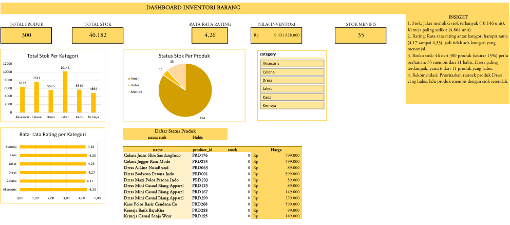

# Dashboard Inventori Produk (Excel)
Dashboard inventori untuk 300 produk pakaian, dibuat dengan Excel.

   
## Tujuan
Memantau kondisi stok, rating, dan nilai inventori per kategori, serta
mengidentifikasi produk yang perlu direstock.

## Dataset
`products.csv`: 300 produk (kategori, sub kategori, harga, stok, brand,
material, rating).

## Langkah pengerjaan
1. Membersihkan data: menyeragamkan kategori (mis. "T-Shirt" dan "kaos"),
   mengubah rating menjadi angka, menghapus baris kosong.
2. Menambah kolom bantu: status stok (Habis / Menipis / Aman) dan nilai stok.
3. Membuat PivotTable dan PivotChart.
4. Menyusun dashboard: 5 KPI, 3 chart, slicer kategori, daftar produk
   per status stok.

## Temuan utama
- Jaket memiliki stok terbanyak (10.146 unit), Kemeja paling sedikit (4.864).
- Rating antar kategori hampir sama (4,17 sampai 4,33).
- 46 dari 300 produk (sekitar 15%) menipis atau habis.
- Nilai inventori sekitar Rp 9,03 miliar.

## File
- `product_inventori.xlsx`: file Excel interaktif
- `dashboard_product_inventori.pdf`: tampilan dashboard
